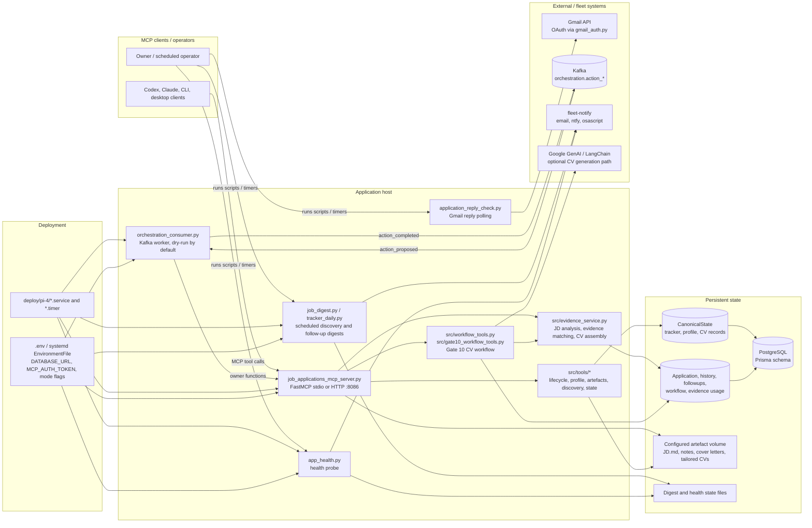

# Job Applications Codebase Technical Diagram

## Main Runtime Paths

| Path | Main responsibility |
| --- | --- |
| `job_applications_mcp_server.py` | FastMCP entrypoint, HTTP auth, tool registration, legacy owner functions. |
| `src/tools/_state.py` | Shared state helpers, stage machine, Postgres/file backend switching, path handling. |
| `src/tools/lifecycle.py` | Application listing, status, updates, stage changes, applied date handling. |
| `src/tools/profile_tools.py` | Base CV/profile reads and profile refresh helpers. |
| `src/tools/artefacts.py` | Saved artefacts and context-prep persistence helpers. |
| `src/tools/discovery.py` | Daily discovery review and ingestion helpers. |
| `src/evidence_service.py` | Evidence extraction, JD analysis, evidence ranking, CV assembly. |
| `src/evidence_backend.py` | Evidence backend interface and Postgres/in-memory implementations. |
| `src/workflow_tools.py` | Gate 10 workflow tool implementation for clarifying questions and CV revision. |
| `orchestration_consumer.py` | Kafka consumer/producer for AI-Assistant follow-up proposals. |
| `gmail_auth.py`, `application_reply_check.py` | Gmail OAuth and reply monitoring. |
| `prisma/schema.prisma` | Canonical Postgres schema. |

## Key Flows

1. MCP client calls `job_applications_mcp_server.py`.
2. Server routes lifecycle/profile/artefact calls through `src/tools/*`.
3. Canonical tracker/profile/CV payloads persist through `CanonicalState`; richer application/evidence/workflow data persists through Prisma models.
4. Artefacts remain on the configured filesystem volume.
5. Gate 10 CV workflow combines JD criteria, stored evidence, user clarifications, and optional GenAI output.
6. Kafka orchestration worker consumes proposed follow-up actions, validates through owner functions, and publishes completion events.
7. Systemd units run MCP, orchestration, digest, and health processes on pi-4.

