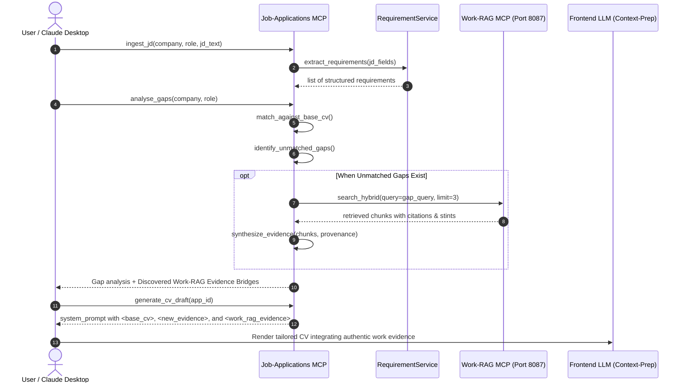

# Architecture & Design: Work-RAG Evidence Retrieval for CV Customization

**Status:** APPROVED FOR IMPLEMENTATION (See implementation_plan.md)  
**Epic:** [JOBS-11](https://gs-pi-4.tail210e4f.ts.net:3040/fleet/projects/JOBS/issues/11)  
**User Stories:** [JOBS-12](https://gs-pi-4.tail210e4f.ts.net:3040/fleet/projects/JOBS/issues/12), [JOBS-13](https://gs-pi-4.tail210e4f.ts.net:3040/fleet/projects/JOBS/issues/13), [JOBS-14](https://gs-pi-4.tail210e4f.ts.net:3040/fleet/projects/JOBS/issues/14), [JOBS-15](https://gs-pi-4.tail210e4f.ts.net:3040/fleet/projects/JOBS/issues/15)  
**Author:** Antigravity / Pair Programming  
**Last Updated:** 2026-10-26  

---

## 1. Problem Statement & Motivation

### Current Limitation
The candidate's Base / Reference CV (`Reference_CV.md`) is a concise executive summary representing high-level milestones. However, enterprise job descriptions (JDs) routinely require granular proof of specific technologies (e.g. SAP ERP, AWS GovCloud, Boomi/MuleSoft displacements), specific public sector agencies (e.g. GovTech, Synapxe, PSD, MTI), specialized deal sizes, or niche methodologies.

Currently:
1. `analyse_gaps` marks these unmatched criteria as missing skills or gaps.
2. The user must manually supply details via `answer_clarifying_questions`, or the tailored CV omits authentic experience the candidate actually possesses.
3. Meanwhile, the fleet's **`Work-RAG`** platform (`ai-assistant-db` / `wka_core`) already holds extensive indexed archives: closed deal analyses, project deliverables, customer meeting notes, emails, architecture proposals, and partner records spanning past career stints.

### Desired State
Whenever a JD is ingested and a skill/requirement is not demonstrated in the Base CV:
1. Job-Applications autonomously generates semantic queries for the missing capabilities.
2. Job-Applications queries `Work-RAG` via canonical MCP tools (`search_hybrid`, `search_semantic`).
3. Retrieved factual project evidence is synthesized into structured `EvidenceItem` records with clear provenance (source doc, date, stint).
4. Discovered evidence is automatically injected into Gate 10 Context-Prep prompts (`analyse_gaps` and `generate_cv_draft`), enabling custom-built CVs grounded in verifiable past accomplishments without user overhead or LLM hallucination.

---

## 2. Fleet Architecture & Domain Boundaries

Under Fleet Architecture Policy (Zero-Infringement & Anti-Mock):
- **`Work-RAG` owns**: Vector embeddings, document ingestion/chunking, semantic & hybrid search (`pgvector`).
- **`Job-Applications` owns**: Career pipeline tracking, resume indexing, interview telemetry, CV tailoring.
- **Rule**: `Job-Applications` **MUST NOT** connect directly to `ai-assistant-db` or duplicate vector distance math. All knowledge discovery must cross boundaries via the canonical `Work-RAG` FastMCP server (`search_hybrid`, `search_semantic`).



---

## 3. Component Architecture & Detailed Design

### 3.1 Gap-to-Query Translation (`WorkRagQueryPlanner`)
Located in `src/tools/work_rag_adapter.py`:
- Extracts core technical phrases, domain keywords, and functional actions from JD gap items.
- Eliminates generic boilerplate ("candidate must possess", "strong track record in").
- Generates up to 3 focused queries per gap category:
  - **Technology / Product**: e.g., `"SAP S/4HANA integration migration"`
  - **Domain / Client**: e.g., `"Singapore Public Sector GovTech tender RFP"`
  - **Competitive / Methodology**: e.g., `"Boomi MuleSoft competitive displacement LCNC"`

### 3.2 Cross-Domain Client (`WorkRagClient`)
- Communicates with Work-RAG over Tailscale (`http://gs-pi-4.tail210e4f.ts.net:8087` or fleet MCP proxy).
- Standardizes payload formatting:
  ```python
  payload = {
      "query": query,
      "limit": limit or 3,
      "classification": "WORK" # Focus on work archives and deliverables
  }
  ```
- Implements circuit breaker: 3-second timeout, graceful fallback to empty results if Work-RAG is temporarily unreachable or offline.

### 3.3 Evidence Synthesis & Fabrication Guard (`CareerEvidenceEnricher`)
- Filters chunks below relevance threshold (RRF score or similarity < 0.70).
- Extracts verifiable metrics: deal size, revenue, client agency, timeline, stint employer.
- Constructs structured evidence:
  ```json
  {
    "statement": "Led competitive displacement of Boomi across 14+ enterprise accounts, expanding GovTech/PSD whole-of-government footprint.",
    "source_type": "work_rag_retrieval",
    "source_reference": "Sales_Flash_Deal_Intelligence_Analysis.docx (Workato / March 2026)",
    "confidence": "LEVEL_A",
    "metrics": {"deal_count": 14, "segment": "Singapore Public Sector"},
    "stint": "Workato",
    "user_confirmed": false
  }
  ```
- Enforces Fabrication Guard: Every claim injected into the CV draft prompt must retain its document citation and stint attribution.

### 3.4 Gate 10 Context-Prep Integration
1. **`analyse_gaps(company, role_title)`**:
   - Augmented to include a new field: `"work_rag_evidence"`.
   - Displays discovered evidence bridges for each missing requirement, showing the user what authentic projects were recovered.
2. **`generate_cv_draft(application_id, jd_content, evidence_items)`**:
   - Augments `system_prompt` payload:
     ```markdown
     <work_rag_evidence>
     The following verified experiences from past career stints were retrieved from Work-RAG archives to fulfill specific JD criteria missing in the Base CV:
     - [Workato / GovTech] Led competitive win and contract renewal with GovTech Singapore for enterprise integration platform. (Citation: GovTech - Workato Subscription Renewal - DocuSigned.pdf)
     - [Workato] Closed 14+ competitive displacements against Boomi and MuleSoft across enterprise and public sector accounts. (Citation: Sales_Flash_Deal_Intelligence_Analysis.docx)
     </work_rag_evidence>
     
     Instruction: Incorporate these verified experiences into the appropriate historical roles (e.g. Workato, VISEO) in the tailored CV without altering career dates or inflating titles.
     ```
3. **Dedicated MCP Tool (`enrich_gaps_from_work_rag`)**:
   - Exposed as `@mcp.tool()` so Claude Desktop / agents can run an explicit deep-dive retrieval for a specific role or company on demand.

---

## 4. Failure Modes & Defenses

| Failure Scenario | Impact | Mitigation / Defensive Architecture |
| :--- | :--- | :--- |
| **Work-RAG MCP Unreachable** | Remote service down or Tailscale timeout. | Non-blocking try/except in `WorkRagClient`; returns `[]` with warning log. Gate 10 workflow proceeds normally using Base CV. |
| **Irrelevant / Noisy Chunks** | Chunks match keywords but describe team members or unrelated projects. | RRF score cutoff + company/stint constraint; prompt instructs LLM to only incorporate evidence attributed to the candidate's direct stint. |
| **Token Bloat** | Work-RAG chunks consume excessive LLM context tokens. | Strict chunk cap: top 2 chunks per gap, truncated to 400 characters per chunk, focusing on the synthetic summary and key metrics. |
| **Hallucination / Over-tailoring** | LLM invents employment stints not in Base CV. | Fabrication guard instruction in prompt: "Do NOT create new employers or change career timeline; integrate new project evidence strictly within existing stints." |

---

## 5. Testing & Verification Strategy

1. **Unit Tests (`tests/unit/test_work_rag_adapter.py`)**:
   - Mock Work-RAG MCP response parsing and query generation.
   - Test circuit breaker and timeout fallback.
   - Verify synthesis into `EvidenceItem` schema.
2. **Integration Tests (`tests/integration/test_work_rag_gap_enrichment.py`)**:
   - Test `analyse_gaps` flow when gaps are present vs when Base CV fully covers JD.
   - Test `generate_cv_draft` prompt formation containing `<work_rag_evidence>`.
3. **Live Tailscale Acceptance (`tests/acceptance/test_live_work_rag_retrieval.py`)**:
   - Perform read-only query against live Work-RAG MCP on `gs-pi-4:8087` verifying real chunk retrieval.
